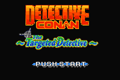
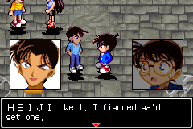
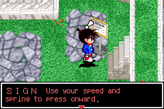

<p align="center">
  <h1>Detective Conan: Nerawareta Tantei — The Targeted Detective</h1>
  <i>English fan translation patch v1.0.</i><br/>
  Original title: <i>名探偵コナン 狙われた探偵</i> (<i>Meitantei Conan: Nerawareta Tantei</i>)
</p>

<p align="center">
  &nbsp;
  &nbsp;
  
</p>

Full source repository and English translation patch for *Detective Conan: Nerawareta Tantei — The Targeted Detective* for the Game Boy Advance.

This repository contains my translations for the game, including some reworked graphic assets (cutscenes, banners, UI screens, gadget descriptions), dialogue scripts and  dual-character font generation.

---

## 💾 Downloads & Patching

| File | Size | Description |
| :--- | :--- | :--- |
| **Original Japanese ROM** | 8 MiB | Clean, unheadered Japanese ROM of *Meitantei Conan - Nerawareta Tantei* (`.gba`). |
| **English BPS Patch** | 8.03 MiB | [**Download Detective_Conan_Nerawareta_Tantei_English_v1.0.bps**](https://github.com/jjb781017-arch/detective-conan-nerawareta-tantei-english-gba/releases/latest/download/Detective_Conan_Nerawareta_Tantei_English_v1.0.bps) |
| **Patched English ROM** | 16 MiB | `Detective Conan - English Translated.gba` (generated via patcher or build script). |

> [!NOTE]
> **You need to provide the original Japanese ROM (.gba) yourself. This repository does not contain the ROM.**

### Method 1: Online Web Patcher (Easiest for Mobile & Phones)

You can patch directly in your phone or PC browser with zero software downloads:
1. Open the [**Online Web Patcher**](https://jjb781017-arch.github.io/detective-conan-nerawareta-tantei-english-gba/).
2. Select your clean Japanese ROM (`.gba`).
3. Tap **Apply Patch & Download** to get your translated English ROM ready to play.

### Method 2: Windows Drag & Drop

1. Drag and drop your Japanese ROM (`.gba`) directly onto [`WINDOWS_DROP_CONAN_GBA_HERE.bat`](WINDOWS_DROP_CONAN_GBA_HERE.bat).
2. The patched file will be generated in the project root.

### Method 3: Emulator Soft-Patching

You can patch the game through GBA emulators through soft-patching without modifying your original ROM file:

1. Download [**`Meitantei Conan - Nerawareta Tantei.bps`**](https://github.com/jjb781017-arch/detective-conan-nerawareta-tantei-english-gba/releases/latest/download/Meitantei.Conan.-.Nerawareta.Tantei.bps) from the latest release (or copy from [`patch/`](patch/)).
2. Place it in the same folder as your clean Japanese ROM with matching base filenames:
   ```
   Games/
   ├── Meitantei Conan - Nerawareta Tantei.gba
   └── Meitantei Conan - Nerawareta Tantei.bps
   ```
3. Load `Meitantei Conan - Nerawareta Tantei.gba` in your GBA emulator. The emulator will automatically apply the English patch in memory. If it doesn't automatically apply the patch, you can manually apply the patch in the emulator.

### Method 4: Third-Party Online Patchers

You can also apply the patch through third-party online tools:
1. Open an online BPS patcher (like [Romhacking.net Patcher](https://www.romhacking.net/patch/) or [Hack64 Patcher](https://hack64.net/tools/patcher.php)).
2. Select your clean Japanese ROM (`.gba`) as the Source ROM.
3. Select the [**`Detective_Conan_Nerawareta_Tantei_English_v1.0.bps`**](https://github.com/jjb781017-arch/detective-conan-nerawareta-tantei-english-gba/releases/latest/download/Detective_Conan_Nerawareta_Tantei_English_v1.0.bps) patch file.
4. Click Apply / Download to receive your patched English ROM.

*Alternative for Linux / macOS terminal:* Run `./patch/apply-patch.sh path/to/clean_rom.gba`.

---

## 📋 Project Status

> [!NOTE]
> **Status: This is still a WIP, any help in getting this to the finish line is appreciated**
>
> I've gone through most of the scripts (all 6 cases, minigames, graphics, and system menus) and have roughly translated them as best as I could.  It is fully playable from start to finish. Dialogue lines have been roughly translated and appear in game but have not yet been properly localized and proofread, which leads me to the tasks still at hand.

### Pending Tasks

1. **Epilogue Riddle Cards & Gadget Cards (Needs Localization Adaptation)**
   * The 100 epilogue riddle cards and gadget descriptions are currently translated directly from the Japanese text, but have **not yet been localized or adapted**.
   * The original Japanese riddles rely heavily on Japanese-specific wordplay, kanji radical analysis, stroke counts, and other stuff. So none of the riddles make sense, for now most of the riddles just use the romaji answer on an English keyboard. What we need to do to translate this properly is to:
     * Adapt all the riddles into a solvable,  English riddle or clue while preserving the original tone and spirit and preferably the same answer too. 
     * Rewrite in-game hints to match the new English clues.
     * Update accepted answer strings and metadata in `data/riddles_analysis.json` so the game's answer parser accepts the localized solutions. (P.S. we can add multiple answers)

2. **Speaker Nameplate Spacing**
   * Currently long character names (such as `INSPECTOR MEGURE`, `MITSUHIKO`) are cut off. This is because in the original engine, character names were written in kanji or katakana and were only 2 to 4 full-width glyphs long (e.g. 目暮, 阿笠). The game's nameplate drawer writes directly into the dialogue text cursor on Line 1 ($x = 8 + 12 \times \text{slots}$). English names are significantly longer in letter count, shifting the starting cursor far to the right and leaving as few as 16–18 characters for dialogue on that line.
   * So, refactoring the engine's nameplate rendering hook to decouple nameplate drawing from the dialogue cursor, allowing Line 1 to use its full horizontal width regardless of name length might be the solution.

3. **Dual-Glyph Font Table**
   * As for the dialogs, the GBA engine's native text renderer draws fixed 12×12 pixel tile slots. With 1 character per slot, the 240px GBA screen fits only ~17 English letters per line. Because of this, only few letters get shown and leads to  fragmented reading and takes so many boxes to show a sentence.
   * A solution I came up for this is to implement a dynamic pair-glyph system that packs two 5×9 pixel English letters side-by-side inside each single 12×12 GBA tile slot (with a 1px spacer). This doubles the per-line character capacity from 17 up to 34 characters per line.

4. **Minigame Tutorial Screens**
   * The tutorial screens for the minigames are currently placeholders with early rough drafts that need cleanup, better fonts and polish.
   * While the rules and button instructions are translated and fully readable so players can clear the cases, the graphic layouts, diagram labels, and typography are early rough drafts that need visual cleanup, formatting polish, and proper alignment.

5. **Untranslated Visual Assets**
   * There are still a handful of assets that need translation in the game.
   * If you want to update or add more, you can find dimension requirements in [`assets/needs_translation/`](assets/needs_translation/).

---

## 🛠️ Editing the Script & Graphics

* **Dialogue & Narration:** Plain JSON files in `data/dialogue_translations.json` and `data/narration_translations.json`.
* **Speaker Nameplates:** `data/speaker_nameplates.json`.
* **Riddle Cards:** `data/riddles_analysis.json`.
* **Asset Graphics:** PNG assets in `assets/` (cutscenes, banners, UI screens).
  * **Size requirement:** Graphics **must** match their exact target pixel dimensions (full screens at **240 × 160 px**; banners at their specific slot dimensions like 176×64 or 128×64). Never save as JPEG. See [`assets/README.md`](assets/README.md) for the complete dimension specification.

---

## 🏗️ Building from Source

Requirements: [Node.js](https://nodejs.org/) (v18 or higher, zero external npm packages required).

```bash
# 1. Place your clean ROM in the repository root or pass its path:
node build.js "path/to/Meitantei Conan - Nerawareta Tantei.gba"

# Or with npm:
npm run build
```

The build script will:
1. Re-encode the dual-character dynamic font table for the current script.
2. Compress and inject translated cutscene, menu, and UI graphics from `assets/`.
3. Inject dialogue lines, nameplate logic, and relocated scene pointers.
4. Run 25 ROM integrity verifications and LZ77 VRAM decompressor audits.
5. Generate fresh BPS patches in `patch/`.

### Validation Commands

```bash
# Verify JSON syntax and check for long lines
npm test

# Check all dialogue and narration against GBA hardware clipping limits
npm run check-widths

# Verify patched ROM structure against clean ROM (25 automated tests)
npm run verify

# Audit LZ77 compression blocks for hardware decompressor safety
npm run audit-lz77

# Test BPS patch application against your clean ROM
npm run patch
```
